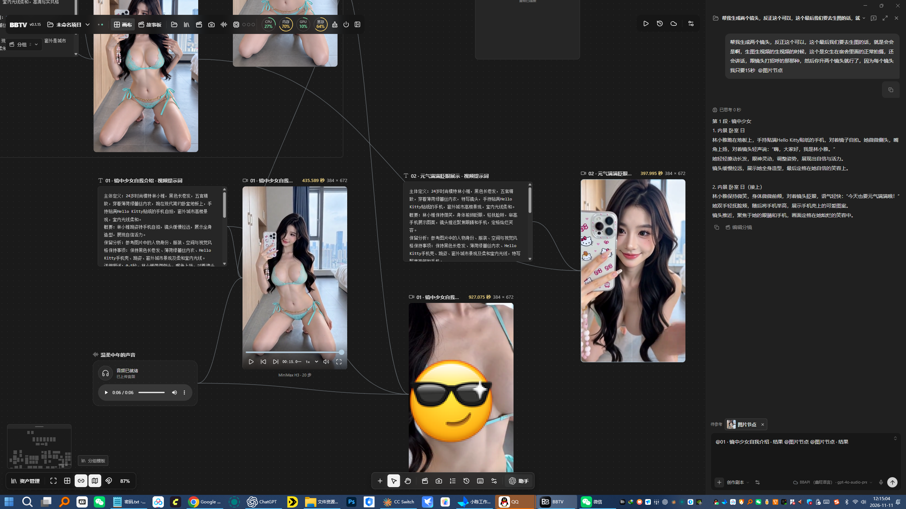
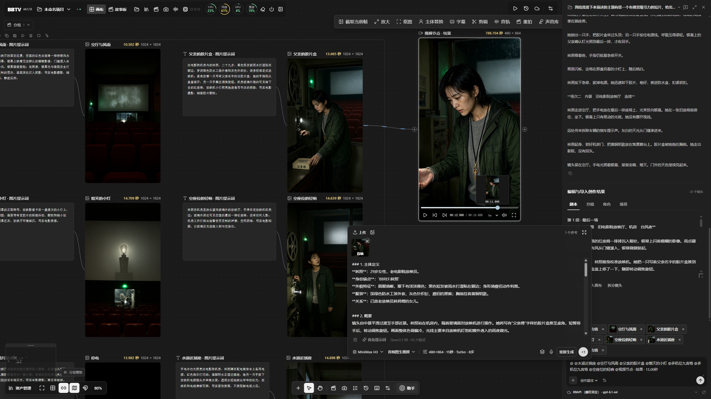
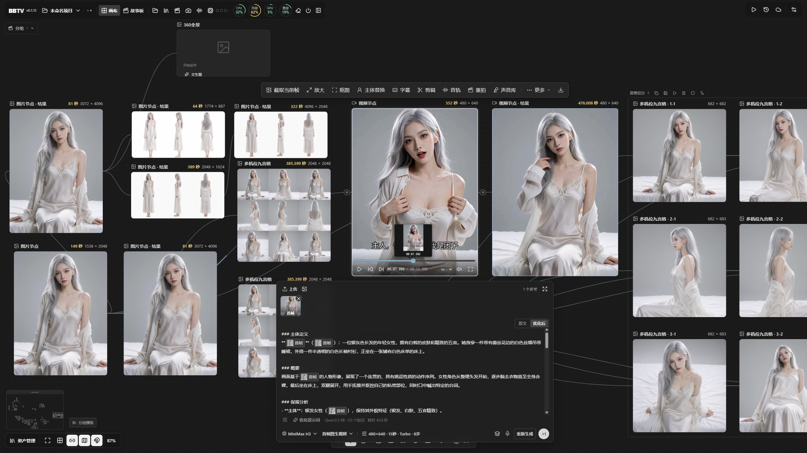
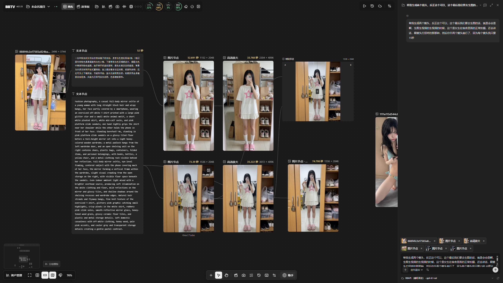
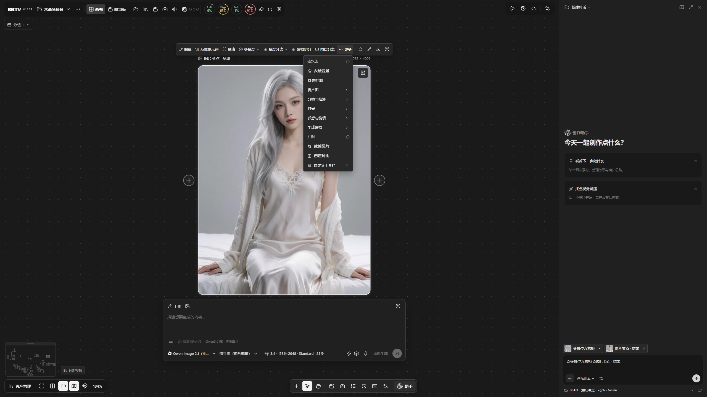
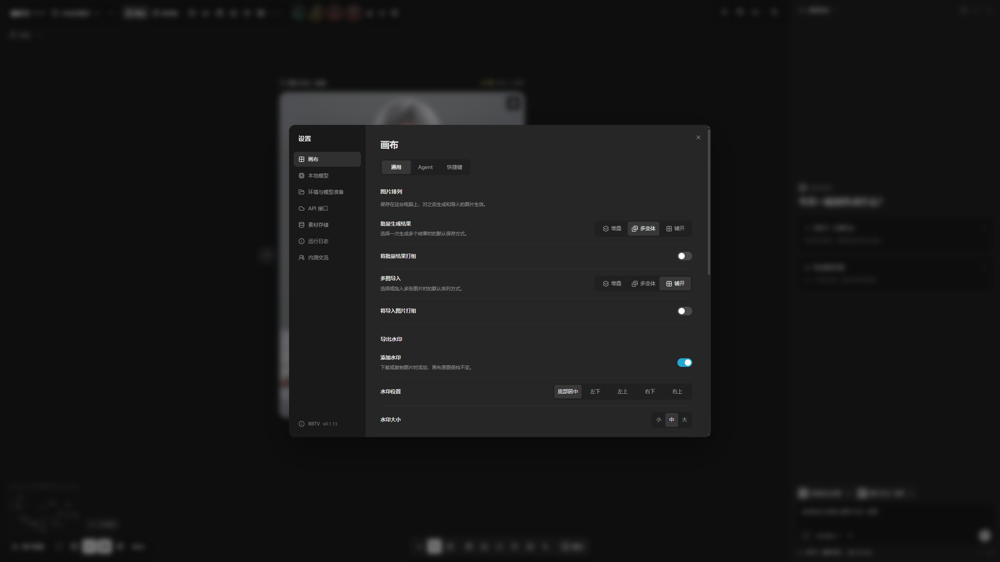
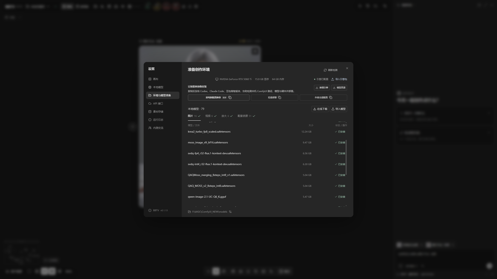
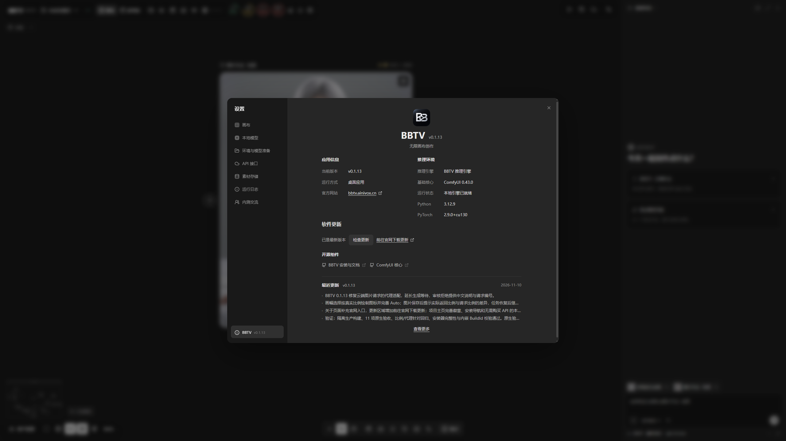
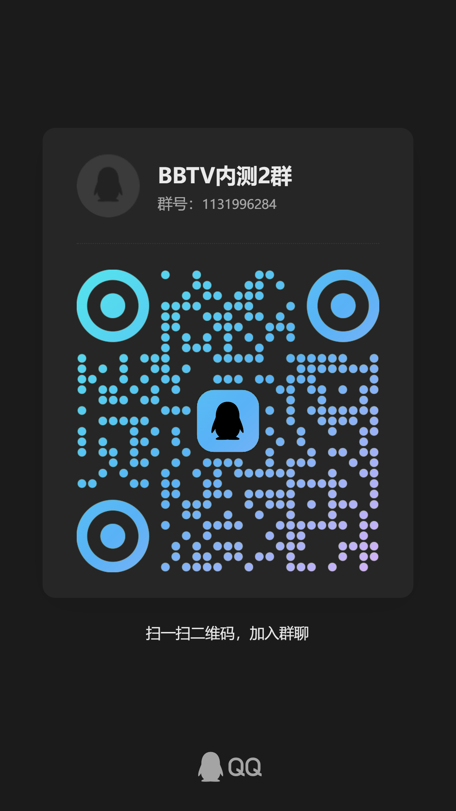

<div align="center">

# BBTV 无限画布

### 图片、视频与声音，在一张画布中创作

[](https://github.com/BBAIGC/BBTV-AI-Canvas/releases/latest)
[](https://bbtv.ainivox.cn)
[](#开始使用下载与安装)
[](#开始使用下载与安装)

**支持的本地模型**

[](https://huggingface.co/Qwen/Qwen-Image)
[](https://huggingface.co/Comfy-Org/MOSS-Image)
[](https://huggingface.co/black-forest-labs/FLUX.1-Krea-dev)
[](https://huggingface.co/Tongyi-MAI/Z-Image-Turbo)
<br>
[](https://huggingface.co/Comfy-Org/MiniMax-H3)
[](https://huggingface.co/Comfy-Org/MiniMax-H3-Image)
[](https://huggingface.co/numz/SeedVR2_comfyUI)
[](https://huggingface.co/Qwen)

[使用说明](#从参考素材到完整创作) · [下载安装](#开始使用下载与安装) · [模型下载](MODELS.md) · [智能体部署](#让智能体协助部署) · [版本清单](release-notes/0.1.16.md)

</div>

## 开始使用：下载与安装

### [官网下载 Windows 安装包](https://bbtv.ainivox.cn) · [GitHub 直接下载](https://github.com/BBAIGC/BBTV-AI-Canvas/releases/latest)

1. **安装 BBTV。** 下载 Windows 安装包并完成安装，已有版本可在“关于 BBTV”检查更新。
2. **准备引擎与模型。** 打开[统一资源库](https://pan.baidu.com/s/1DNzXSlrRB0bNPPT78RdrRQ?pwd=rpmx)，提取码 **rpmx**；已有 ComfyUI 和匹配模型可直接复用。
3. **连接本地引擎。** 在设置中选择引擎目录，并参考 [MODELS.md](MODELS.md) 核对所选模型的编码器、VAE 和其他依赖。
4. **开始第一次创作。** 新建项目，导入参考图片，选择模型，输入要求并生成。

[v0.1.16 更新内容](release-notes/0.1.16.md)


**把想法、参考图、分镜和生成结果放进一张无限画布，接着创作。** BBTV 将常用的本地图片、视频与放大流程做成可以直接使用的操作：选择模型、提供参考、写下要求，无需手动搭建 ComfyUI 节点工作流。

**无需购买 API。本地功能永久免费，也没有按次生成费用。** 本地模型在自己的电脑运行，需要适合的硬件、推理引擎和相应模型。



从参考图、剧本到多镜头视频，生成耗时和结果直接显示在画布上。图中两条 15 秒、384 × 672 视频的本机生成记录约为 **6 分 38 秒**和 **7 分 16 秒**；速度会随模型、参数、缓存和硬件变化。

MiniMax H3 在远景、小脸画面中可能出现面部细节失真。**视频人脸修复正在完善，将加入视频处理流程。**



从故事构思出发，把剧本、角色、场景、图片提示词和视频结果放在同一张画布上。右侧助手整理创作内容，左侧节点承接素材与结果，创作脉络始终可见。

以下展示均为作者提供的软件实机截图。

## 从参考素材到完整创作

| 想做什么 | 在 BBTV 中怎么做 |
|---|---|
| 图片生成与编辑 | 使用 Qwen Image、MOSS、Krea、Z-Image 等本地路线，围绕参考图继续创作 |
| 反推与提示词 | 手动开始反推，选择目标模型风格、语言、详细程度与长度；前置提示词可调整和重置 |
| 多图创作 | 多选图片，直接输入共同创作要求，保留素材之间的联系 |
| 视频与分镜 | 整理剧本、角色、场景与镜头，再使用本地 MiniMax H3 生成视频 |
| 图片放大 | 选择 VOSR2、SeedVR2 等路线，逐张或整组处理 |
| 宫格与批量处理 | 切分宫格、选择倍率、排队生成，让结果按组整齐排列 |
| 整理与交付 | 节点分组、复制到其他画布、保存项目、批量导出图片或 ZIP |

支持的具体能力取决于已安装的模型和依赖。各条路线按需配置，可先完成一个功能，再逐步扩展。

### 多角度参考，接着生成视频

围绕同一张人物或产品参考图继续创作，生成多角度视图、切分九宫格，再把选定图片作为视频参考。MiniMax H3 的视频节点可直接播放和逐帧查看，首帧、提示词与生成参数集中在当前节点下方。



### 从反推提示词到放大与对比

参考图可以连出文本节点，保留反推内容后继续调整、复用。图片生成、高清放大和 A/B 对比沿连线展开，方便把同一思路的不同结果并排检查。



### 图片工具，就在选中素材旁

图片节点提供编辑、反推提示词、高清放大、多角度、角度分离、宫格切分与图层分离入口；更多菜单集中收纳去除背景、灯光、裁剪和对比等工具。具体处理需要相应模型与依赖，可按自己的创作需求安装。



### 画布按自己的习惯整理

批量生成与多图导入可分别选择堆叠、多变体或铺开，也可把结果自动打组。导出水印支持位置与大小设置，水印作用于下载和复制，画布中的原图继续保留。



### 引擎与模型，统一准备

环境页集中显示当前硬件、引擎连接和本地模型资源，支持导入引擎、导入模型、在线下载与刷新检测。已经存在的 ComfyUI 与模型可以复用；下载前先选需要的功能，再按公开清单检查配套依赖。



## 让智能体协助部署

选择适合自己的方案，复制完整提示词，发给 [Codex](https://chatgpt.com/codex)、[Claude Code](https://claude.com/product/claude-code)、[豆包工作](https://www.doubao.com/work)、[WorkBuddy](https://www.workbuddy.cn/)、[字节 TRAE](https://www.trae.cn/download)、[MiniMax Code](https://code.minimax.cn/about) 等智能体。三套提示词与软件、官网使用同一份内容，都会先核对本机配置并复用已有模型。下方提示词默认展开，也可收起后快速浏览其他内容。

### 1. 按电脑配置推荐

先检测硬件与已有资源，再选择适合本机的图片、视频或放大能力。

<details open>
<summary>完整部署提示词</summary>

```text
请协助我在这台 Windows 电脑上配置 BBTV 本地推理引擎与模型。按下列目标执行实际检查和部署，保留现有 ComfyUI、模型、画布与用户设置。
方案：按电脑配置推荐
1. 优先根据这台电脑的实际显存、内存和磁盘空间推荐组合；先完成可运行的最小闭环，再按我的用途逐项增加功能。
2. 如果显存或存储不足，说明具体不满足的模型与替代方案，不因为作者电脑能运行就承诺本机也能运行。

共同执行要求：
1. 先检测 Windows 版本、CPU、内存、GPU、可用显存、驱动和目标磁盘剩余空间。记录实际检测结果；不要用作者电脑配置代替我的硬件。
2. 如果尚未安装 BBTV，只从官网或官方 GitHub Releases 获取 Windows 二进制安装器，核对版本和校验值后安装；GitHub 是安装包与使用文档入口，不要求克隆源码或在本机编译。
3. 定位已有 ComfyUI（包括便携版、整合包和独立 Python 环境）、extra_model_paths.yaml、BBTV 引擎与模型目录。先检查常见安装位置和用户指定目录，再按实际证据扩大查找；不要全盘读取无关文件。
4. 资源库按“01-基础必需”和“02-可选扩展”分层，共享依赖只保留一份；先按清单核对所选功能，不需要为不同方案下载两份相同权重。基础层覆盖一组完整常用能力，但按电脑配置推荐时仍应只准备本机所需资源。
5. 复用已存在且匹配的模型文件，按公开清单核对大小与 SHA256，不能只凭名称判断；名称不同但哈希一致的文件也是可复用资源。检查并使用 extra_model_paths.yaml；如果 BBTV 需要清单指定的模型名称，可采用文件联接或额外路径配置满足别名，保留原权重原位，不搬移、不重复下载。仅下载缺失且适合本机的资源，图片、视频、文本编码器、VAE、LoRA 和放大模型必须按依赖配套，不把包名当作已完整可用的证据。
6. 按资源清单的 installRoot 和 installRelativePath 分流安装，不把“01-基础必需/02-可选扩展”分类目录整层嵌入 models。Ollama 模型要保留 manifest、模型 blob 与图像投影器的完整引用，不能只放一个同名 GGUF。遵守每个模型各自的许可与使用条款。
7. 先给出本机适合的功能组合、所需磁盘空间与缺失资源，再部署已选择的组合。不要覆盖同名模型或删除现有环境；修改配置前保留可恢复备份，不强制迁移已有模型。
8. 网盘分享页不是文件直链。使用已公开的真实下载链接；若资源链接尚未开放，或百度网盘需要我完成登录、转存或下载，请明确说明并使用我提供的本地压缩包，不编造链接或校验值。
9. 部署后检查核心依赖、模型文件与本地推理服务。启动 BBTV，在设置的本地引擎中选择正确目录，保存配置并按需重启；分别验证引擎连通、模型列表和对应功能是否可用。未经我选择，不调用收费云端接口。
10. 最后列出实际使用的路径、复用与新增文件、验证结果和仍缺少的资源；失败时保留成功部分，说明下一步，不把未验证的功能标为成功。

官方网站：https://bbtv.ainivox.cn
安装包与使用文档：https://github.com/BBAIGC/BBTV-AI-Canvas
模型清单：https://github.com/BBAIGC/BBTV-AI-Canvas/blob/main/docs/model-distribution-inventory.json
推理引擎：https://pan.baidu.com/s/1DNzXSlrRB0bNPPT78RdrRQ?pwd=rpmx（提取码：rpmx）
模型资源：https://pan.baidu.com/s/1DNzXSlrRB0bNPPT78RdrRQ?pwd=rpmx（提取码：rpmx）
作者电脑：i7-12700KF · 64 GB 内存 · RTX 5060 Ti 16 GB
```

</details>

### 2. 轻量部署

按常用功能减少下载；轻量指资源组合更少，不代表适合低显存。

<details open>
<summary>完整部署提示词</summary>

```text
请协助我在这台 Windows 电脑上配置 BBTV 本地推理引擎与模型。按下列目标执行实际检查和部署，保留现有 ComfyUI、模型、画布与用户设置。
方案：轻量部署
1. 先询问我主要需要图片生成、视频生成还是图片放大，只部署选定功能和必须的配套依赖，不把作者完整模型库全部下载。
2. 轻量是相对作者全套减少资源，并不是低显存保证。特别核对视频模型、编码器、VAE 和默认加速 LoRA 的总大小，以及本机可用显存与内存。

共同执行要求：
1. 先检测 Windows 版本、CPU、内存、GPU、可用显存、驱动和目标磁盘剩余空间。记录实际检测结果；不要用作者电脑配置代替我的硬件。
2. 如果尚未安装 BBTV，只从官网或官方 GitHub Releases 获取 Windows 二进制安装器，核对版本和校验值后安装；GitHub 是安装包与使用文档入口，不要求克隆源码或在本机编译。
3. 定位已有 ComfyUI（包括便携版、整合包和独立 Python 环境）、extra_model_paths.yaml、BBTV 引擎与模型目录。先检查常见安装位置和用户指定目录，再按实际证据扩大查找；不要全盘读取无关文件。
4. 资源库按“01-基础必需”和“02-可选扩展”分层，共享依赖只保留一份；先按清单核对所选功能，不需要为不同方案下载两份相同权重。基础层覆盖一组完整常用能力，但按电脑配置推荐时仍应只准备本机所需资源。
5. 复用已存在且匹配的模型文件，按公开清单核对大小与 SHA256，不能只凭名称判断；名称不同但哈希一致的文件也是可复用资源。检查并使用 extra_model_paths.yaml；如果 BBTV 需要清单指定的模型名称，可采用文件联接或额外路径配置满足别名，保留原权重原位，不搬移、不重复下载。仅下载缺失且适合本机的资源，图片、视频、文本编码器、VAE、LoRA 和放大模型必须按依赖配套，不把包名当作已完整可用的证据。
6. 按资源清单的 installRoot 和 installRelativePath 分流安装，不把“01-基础必需/02-可选扩展”分类目录整层嵌入 models。Ollama 模型要保留 manifest、模型 blob 与图像投影器的完整引用，不能只放一个同名 GGUF。遵守每个模型各自的许可与使用条款。
7. 先给出本机适合的功能组合、所需磁盘空间与缺失资源，再部署已选择的组合。不要覆盖同名模型或删除现有环境；修改配置前保留可恢复备份，不强制迁移已有模型。
8. 网盘分享页不是文件直链。使用已公开的真实下载链接；若资源链接尚未开放，或百度网盘需要我完成登录、转存或下载，请明确说明并使用我提供的本地压缩包，不编造链接或校验值。
9. 部署后检查核心依赖、模型文件与本地推理服务。启动 BBTV，在设置的本地引擎中选择正确目录，保存配置并按需重启；分别验证引擎连通、模型列表和对应功能是否可用。未经我选择，不调用收费云端接口。
10. 最后列出实际使用的路径、复用与新增文件、验证结果和仍缺少的资源；失败时保留成功部分，说明下一步，不把未验证的功能标为成功。

官方网站：https://bbtv.ainivox.cn
安装包与使用文档：https://github.com/BBAIGC/BBTV-AI-Canvas
模型清单：https://github.com/BBAIGC/BBTV-AI-Canvas/blob/main/docs/model-distribution-inventory.json
推理引擎：https://pan.baidu.com/s/1DNzXSlrRB0bNPPT78RdrRQ?pwd=rpmx（提取码：rpmx）
模型资源：https://pan.baidu.com/s/1DNzXSlrRB0bNPPT78RdrRQ?pwd=rpmx（提取码：rpmx）
作者电脑：i7-12700KF · 64 GB 内存 · RTX 5060 Ti 16 GB
```

</details>

### 3. 作者全量配置

按作者资源清单准备完整功能，先核对本机空间与硬件差异。

<details open>
<summary>完整部署提示词</summary>

```text
请协助我在这台 Windows 电脑上配置 BBTV 本地推理引擎与模型。按下列目标执行实际检查和部署，保留现有 ComfyUI、模型、画布与用户设置。
方案：作者全量配置
1. 以作者公开清单为目标逐项核对图片、视频、编辑、放大与配套资源；先统计整套下载和解压空间，列明现有文件可复用的部分。
2. 完整资源数量不等于本机能同时加载。按我的硬件选择精度、分辨率和资源释放策略；作者硬件仅作参考，不把所有模型强行常驻显存。

共同执行要求：
1. 先检测 Windows 版本、CPU、内存、GPU、可用显存、驱动和目标磁盘剩余空间。记录实际检测结果；不要用作者电脑配置代替我的硬件。
2. 如果尚未安装 BBTV，只从官网或官方 GitHub Releases 获取 Windows 二进制安装器，核对版本和校验值后安装；GitHub 是安装包与使用文档入口，不要求克隆源码或在本机编译。
3. 定位已有 ComfyUI（包括便携版、整合包和独立 Python 环境）、extra_model_paths.yaml、BBTV 引擎与模型目录。先检查常见安装位置和用户指定目录，再按实际证据扩大查找；不要全盘读取无关文件。
4. 资源库按“01-基础必需”和“02-可选扩展”分层，共享依赖只保留一份；先按清单核对所选功能，不需要为不同方案下载两份相同权重。基础层覆盖一组完整常用能力，但按电脑配置推荐时仍应只准备本机所需资源。
5. 复用已存在且匹配的模型文件，按公开清单核对大小与 SHA256，不能只凭名称判断；名称不同但哈希一致的文件也是可复用资源。检查并使用 extra_model_paths.yaml；如果 BBTV 需要清单指定的模型名称，可采用文件联接或额外路径配置满足别名，保留原权重原位，不搬移、不重复下载。仅下载缺失且适合本机的资源，图片、视频、文本编码器、VAE、LoRA 和放大模型必须按依赖配套，不把包名当作已完整可用的证据。
6. 按资源清单的 installRoot 和 installRelativePath 分流安装，不把“01-基础必需/02-可选扩展”分类目录整层嵌入 models。Ollama 模型要保留 manifest、模型 blob 与图像投影器的完整引用，不能只放一个同名 GGUF。遵守每个模型各自的许可与使用条款。
7. 先给出本机适合的功能组合、所需磁盘空间与缺失资源，再部署已选择的组合。不要覆盖同名模型或删除现有环境；修改配置前保留可恢复备份，不强制迁移已有模型。
8. 网盘分享页不是文件直链。使用已公开的真实下载链接；若资源链接尚未开放，或百度网盘需要我完成登录、转存或下载，请明确说明并使用我提供的本地压缩包，不编造链接或校验值。
9. 部署后检查核心依赖、模型文件与本地推理服务。启动 BBTV，在设置的本地引擎中选择正确目录，保存配置并按需重启；分别验证引擎连通、模型列表和对应功能是否可用。未经我选择，不调用收费云端接口。
10. 最后列出实际使用的路径、复用与新增文件、验证结果和仍缺少的资源；失败时保留成功部分，说明下一步，不把未验证的功能标为成功。

官方网站：https://bbtv.ainivox.cn
安装包与使用文档：https://github.com/BBAIGC/BBTV-AI-Canvas
模型清单：https://github.com/BBAIGC/BBTV-AI-Canvas/blob/main/docs/model-distribution-inventory.json
推理引擎：https://pan.baidu.com/s/1DNzXSlrRB0bNPPT78RdrRQ?pwd=rpmx（提取码：rpmx）
模型资源：https://pan.baidu.com/s/1DNzXSlrRB0bNPPT78RdrRQ?pwd=rpmx（提取码：rpmx）
作者电脑：i7-12700KF · 64 GB 内存 · RTX 5060 Ti 16 GB
```

</details>

“轻量”指只下载需要的功能和依赖，并不意味着所有低显存电脑都能运行。


## 作者设备与速度参考

作者电脑：i7-12700KF · 64 GB 内存 · RTX 5060 Ti 16 GB。以下是这台设备已有成功任务的记录，模型加载、步数与缓存状态没有统一，不能作为同条件性能比较。

| 功能与模型 | 输出与条件 | 历史记录耗时 |
|---|---|---|
| 图片 · Qwen Image 2.1 Turbo | 1024 × 1824，8 步；20 次记录 | 约 10.5～19.4 秒 |
| 视频 · MiniMax H3 | 15 秒视频，480 × 640 或 480 × 864；7 次记录 | 约 7.9～18.4 分钟 |
| 放大 · VOSR2 | 约 683 方图放大 4 倍，输出约 2732 × 2732；9 次记录 | 约 20.0～49.3 秒 |
| 放大 · VOSR2 | 最长边 4048，输出 4048 × 2699；1 次记录 | 约 32.5 秒 |

作者日常口述参考为 H3 的 15 秒视频约 10 分钟、VOSR2 到 4K 约 20～30 秒、近 1K 图片十多秒；这些口述没有固定全部参数，实际运行可能更慢。普通 Qwen Image 2.1 与 Turbo 的耗时不能混用。公开的精选记录见 [性能记录](docs/performance-reference.json)。

## 模型下载与空间

[统一资源库](https://pan.baidu.com/s/1DNzXSlrRB0bNPPT78RdrRQ?pwd=rpmx) · 提取码 **rpmx**

| 资源层 | 文件数 | 文件合计 |
|---|---:|---:|
| 基础必需组合 | 28 | 103.87 GB |
| 可选扩展 | 94 | 219.94 GB |
| 当前资源清单合计 | 122 | 323.81 GB |

这是作者资源库的分层，并非安装 BBTV 必须一次下载全部文件。按功能计算所需资源，预留下载、解压和运行缓存空间；共用权重只保存一份。

## 自己选择云端服务

需要云端模型时，可以在接口设置里填写自己的服务地址、API Key 和模型，按服务支持的兼容协议自行接入。图片与文字模型可分别配置，服务由自己选择，没有平台绑定。本地路线继续独立使用；云端费用与可用能力由所选服务决定。

## 更新与交流

软件启动时检查新版本，发现更新后可在“关于 BBTV”查看更新内容并下载安装；运行期间每小时继续检查。正在输入或操作弹窗时，启动更新提示会稍后显示。

“关于 BBTV”集中显示应用版本、推理环境、更新入口与最近更新记录，便于检查当前安装状态。



GitHub 保留最近 **6 个稳定版本**的安装包及其校验配套文件。发布第 7 个稳定版后才清理最旧安装包，历史 Release 页面、标签和更新说明继续保留；预发布、草稿、引擎与模型资源不在清理范围内。

内测反馈与使用交流：



## 致谢与第三方声明

BBTV 的画布基础来自 [ZeroLu/open-canvas](https://github.com/ZeroLu/open-canvas)。本地推理使用 ComfyUI 及相应模型生态，感谢相关项目与模型作者。

本仓库提供安装包索引、使用文档和版本说明，程序源码未在此仓库发布。上游 MIT 许可证与第三方声明保留在 [NOTICE.md](NOTICE.md) 及 [LICENSES](LICENSES/open-canvas-MIT.txt)。模型与第三方组件各自适用其原许可证。
