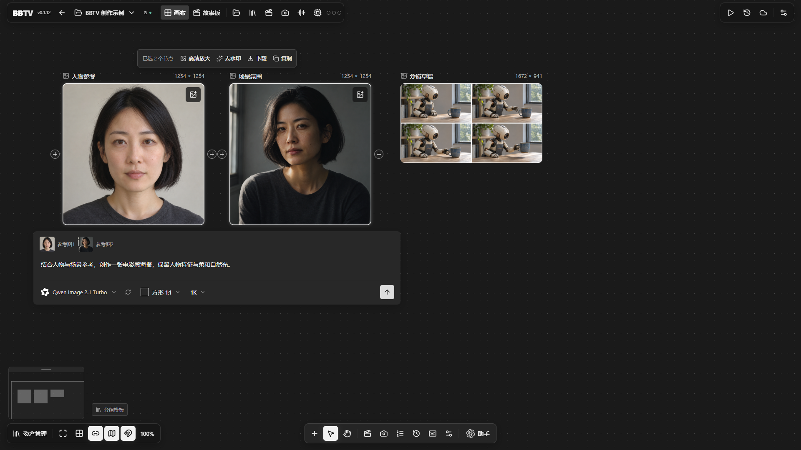
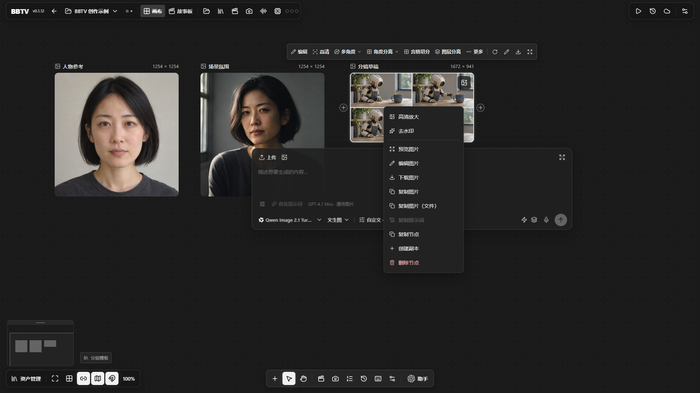
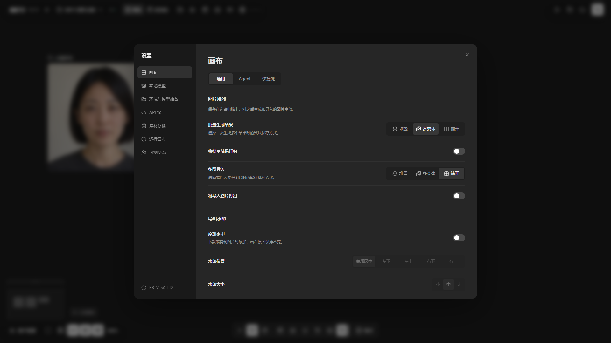

# BBTV 无限画布 · 本地 AI 创作

## [官方网站 · 下载 Windows 版](https://bbtv.ainivox.cn)

[最新版安装包](https://github.com/BBAIGC/BBTV-AI-Canvas/releases/latest) · [模型与依赖](MODELS.md) · [智能体安装](AGENT_INSTALL.md) · [v0.1.12 更新内容](release-notes/0.1.12.md)

**把想法、参考图、分镜和生成结果放进一张无限画布，接着创作。** BBTV 将常用的本地图片、视频与放大流程做成可以直接使用的操作：选择模型、提供参考、写下要求，无需手动搭建 ComfyUI 节点工作流。

**本地功能永久免费。本地模型在自己的电脑运行，无需购买 API，也没有按次生成费用。** 本地运行仍需要适合的硬件、推理引擎和相应模型。

界面示例使用内置素材，展示多图创作与节点操作。

## 从参考素材到完整创作

| 想做什么 | 在 BBTV 中怎么做 |
|---|---|
| 图片生成与编辑 | 使用 Qwen Image、Krea、Z-Image 等本地路线，围绕参考图继续创作 |
| 多图创作 | 多选图片，直接输入共同创作要求，保留素材之间的联系 |
| 视频与分镜 | 整理剧本、角色、场景与镜头，再使用本地 MiniMax H3 生成视频 |
| 图片放大 | 选择 VOSR2、SeedVR2 等路线，逐张或整组处理 |
| 宫格与批量处理 | 切分宫格、选择倍率、排队生成，让结果按组整齐排列 |
| 整理与交付 | 节点分组、复制到其他画布、保存项目、批量导出图片或 ZIP |

支持的具体能力取决于已安装的模型和依赖。各条路线按需配置，可先完成一个功能，再逐步扩展。

## 开始使用

1. 从[官网](https://bbtv.ainivox.cn)或 [GitHub Releases](https://github.com/BBAIGC/BBTV-AI-Canvas/releases/latest) 下载并安装 Windows 版。
2. 准备[推理引擎与模型资源](https://pan.baidu.com/s/1DNzXSlrRB0bNPPT78RdrRQ?pwd=rpmx)，提取码：**rpmx**。已有 ComfyUI 和模型目录可以复用。
3. 在设置中连接本地引擎。参考 [MODELS.md](MODELS.md) 核对所选模型的编码器、VAE 和其他依赖。
4. 新建项目，导入参考素材，选择模型，完成第一次生成。

希望让智能体协助检测配置和部署，可在 [AGENT_INSTALL.md](AGENT_INSTALL.md) 中选择“按电脑配置推荐”“轻量部署”或“作者全量配置”，复制完整提示词。

“轻量”指只下载需要的功能和依赖，并不意味着所有低显存电脑都能运行。

## 作者设备与速度参考

作者电脑：i7-12700KF · 64 GB 内存 · RTX 5060 Ti 16 GB。以下是这台设备已有成功任务的记录，模型加载、步数与缓存状态没有统一，不能作为同条件性能比较。

| 功能与模型 | 输出与条件 | 历史记录耗时 |
|---|---|---|
| 图片 · Qwen Image 2.1 Turbo | 1024 × 1824，8 步；20 次记录 | 约 10.5～19.4 秒 |
| 视频 · MiniMax H3 | 15 秒视频，480 × 640 或 480 × 864；7 次记录 | 约 7.9～18.4 分钟 |
| 放大 · VOSR2 | 约 683 方图放大 4 倍，输出约 2732 × 2732；9 次记录 | 约 20.0～49.3 秒 |
| 放大 · VOSR2 | 最长边 4048，输出 4048 × 2699；1 次记录 | 约 32.5 秒 |

作者日常口述参考为 H3 的 15 秒视频约 10 分钟、VOSR2 到 4K 约 20～30 秒、近 1K 图片十多秒；这些口述没有固定全部参数，实际运行可能更慢。普通 Qwen Image 2.1 与 Turbo 的耗时不能混用。公开的精选记录见 [性能记录](docs/performance-reference.json)。

## 模型下载与空间

[统一资源库](https://pan.baidu.com/s/1DNzXSlrRB0bNPPT78RdrRQ?pwd=rpmx) · 提取码 **rpmx**

| 资源层 | 文件数 | 文件合计 |
|---|---:|---:|
| 基础必需组合 | 28 | 103.87 GB |
| 可选扩展 | 87 | 195.30 GB |
| 当前资源清单合计 | 115 | 299.18 GB |

这是作者资源库的分层，并非安装 BBTV 必须一次下载全部文件。按功能计算所需资源，预留下载、解压和运行缓存空间；共用权重只保存一份。

## 自己选择云端服务

需要云端模型时，可以在接口设置里填写自己的服务地址、API Key 和模型，按服务支持的兼容协议自行接入。图片与文字模型可分别配置，服务由自己选择，没有平台绑定。本地路线继续独立使用；云端费用与可用能力由所选服务决定。

## 更新与交流

软件启动时检查新版本，发现更新后可在“关于 BBTV”查看更新内容并下载安装；运行期间每小时继续检查。正在输入或操作弹窗时，启动更新提示会稍后显示。

内测反馈与使用交流：

## 致谢与第三方声明

BBTV 的画布基础来自 [ZeroLu/open-canvas](https://github.com/ZeroLu/open-canvas)。本地推理使用 ComfyUI 及相应模型生态，感谢相关项目与模型作者。

本仓库提供安装包索引、使用文档和版本说明，程序源码未在此仓库发布。上游 MIT 许可证与第三方声明保留在 [NOTICE.md](NOTICE.md) 及 [LICENSES](LICENSES/open-canvas-MIT.txt)。模型与第三方组件各自适用其原许可证。
