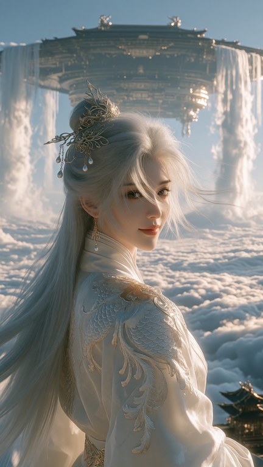
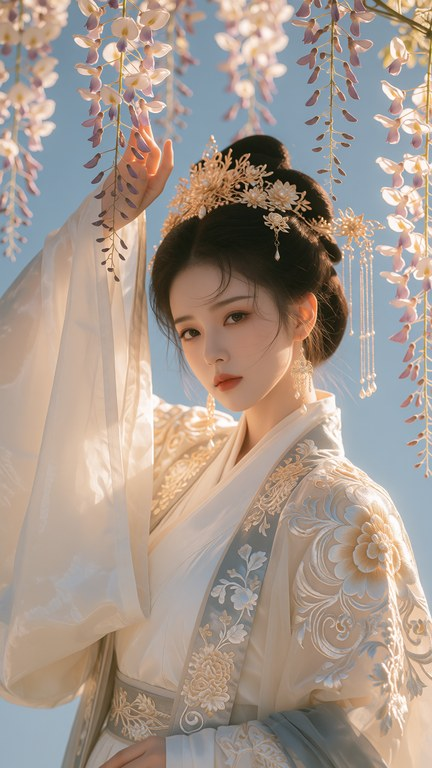
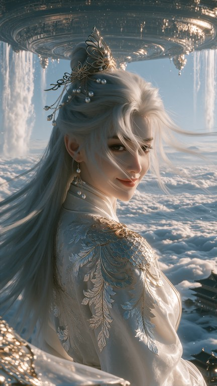

# Krea2 采样与风格对照

BBTV 将 Krea2 风格、连续双采和成图二采放到画布的实际生成流程中。风格 LoRA 可逐项启用、关闭和调节强度；缺少文件时既可单独下载，也可查看整套配套清单。已有匹配模型复用，不要求重复下载。

## 模型与操作

| 选项 | 用途 |
|---|---|
| Krea 2 Turbo | 原有单采流程；连续二采默认关闭 |
| Krea2 · 柔光风格 | 默认影视柔光 0.8、风格滤镜 0.6，均可调整或关闭 |
| Krea2 Turbo · 双采 | 首轮生成后放大潜空间，再用 Krea2 细化 |
| MOSS → Krea2 · 双采 | MOSS 先生成图像，解码后用 Krea2 VAE 重新编码并细化；不直接混接两种潜空间 |
| 图片工具栏“二采” | 对当前节点实际生成的 Krea2/MOSS 成图建立连接结果，原成图保留；重新编码当前图片，不承诺恢复首轮潜空间 |

连续双采的默认对照参数为：首采 7 步，`euler / simple / CFG 1`；潜空间 `bislerp ×1.5`；第二轮总步数 10、从第 4 步开始，实际运行后 6 步。种子相同，两阶段使用相同 Krea2 风格组合。倍率、步数和起始步可调；超出尺寸或批量限制会明确拒绝。

## 截图选中的两张双采小样

| 银发云宫 · 柔光0.8＋滤镜0.6 | 紫藤人像 · 仅柔光0.8 |
|---|---|
|  |  |

这两张均为首采 7 步、潜空间 `bislerp ×1.5`、第二轮总 10 步从第 4 步开始的双采，实际输出 864×1536。左图使用影视柔光 0.8＋风格滤镜 0.6，右图只使用影视柔光 0.8。原图工作流的负向条件使用 `ConditioningZeroOut`，没有另加共用负面提示词。

## 单采风格对照小样

以下是虚构成年人物的实际本地 Krea2 输出。预览均小于 100KB，保留实际画面，不靠预览锐化增加不存在的细节。

| 银发云宫 · 柔光0.8＋滤镜0.6 | 紫藤 · 柔光0.8 | 紫藤 · 柔光0.8＋滤镜0.6 |
|---|---|---|
|  |  |  |

三张都用同一套现有官方 Krea2 基座、文本编码器和 VAE，单采 8 步、CFG 1、`euler / simple`，种子固定为 `20261116`，尺寸 576×1024。两种风格预设沿用同一题材提示词，仅切换 LoRA。相同种子不保证切换 LoRA 后人物身份、表情、构图或光线保持不变。

## 单采与双采实测

| 题材/组合 | 单采原图 | 双采原图 | 实际耗时 |
|---|---:|---:|---:|
| 官方基线 · 银发云宫 | 576×1024 | 864×1536 | 30.240秒 / 40.928秒 |
| 官方基线 · 紫藤金饰 | 576×1024 | 864×1536 | 21.176秒 / 37.802秒 |
| 用户选中 · 银发柔光＋滤镜 | 576×1024 | 864×1536 | 28.821秒 / 42.389秒 |
| 用户选中 · 紫藤仅柔光 | 576×1024 | 864×1536 | 21.242秒 / 39.531秒 |
| 用户选中 · 紫藤柔光＋滤镜 | 576×1024 | 864×1536 | 24.475秒 / 31.849秒 |

双采增加了衣纹、金饰和建筑细节，也可能改变面部、手势与背景结构。它包含新一轮模型去噪，不能当作完全保内容的传统放大。测试中的单采并列预览只做普通 Lanczos 重采样，原始尺寸如表所列，不冒充模型高分辨率输出。

另有一张真实高分辨率验证：1152×2048 首采，潜空间放大 2 倍，再进行 Krea2 二采，实际输出 **2304×4096**，完成耗时 **324.927秒**。VAE 使用分块解码降低解码显存；不是更换为 H3，也不是普通重采样后只改“4K”标签。用户随后要求停止测试，因此未再提交第二张高分辨率任务。

这些结果只验证所列组合和尺寸，不代表任意显卡、复杂画面或更大倍率均有相同速度。原作者工作流中的 Heretic、RealVAE、Musev15 及其他 LoRA 没有被悄悄替代并冒称已复现；文件名里的“MJ”也不等于使用 Midjourney 或保证等同效果。

## 风格文件与下载

设置的 LoRA 分类和生成参数添加列表固定提供影视柔光、风格滤镜、天宫仙境巨大构图三款入口。三份完整权重已同步到 [模型资源库](https://pan.baidu.com/s/1DNzXSlrRB0bNPPT78RdrRQ?pwd=rpmx) 的 `04-可选扩展/01-图片生成/Krea2 LoRA/`，NAS 独立读回 SHA256、整包 MD5 和有序分块列表一致，百度文件大小与上传分块 MD5 校验通过。权重单独下载，不随主程序捆绑；原作者权利保留。

影视柔光、风格滤镜沿用 RunningHubAI 公开源镜像的固定提交 `e73572d26b4983c07d52cd2a79c5b7ebfc068636`，原源站入口保留：

| 文件 | 大小 | SHA256 |
|---|---:|---|
| [影视柔光](https://huggingface.co/RunningHubAI/rh-krea2-cc-mj-lora/resolve/e73572d26b4983c07d52cd2a79c5b7ebfc068636/krea2-Cc-MJ-%E5%BD%B1%E8%A7%86%E6%9F%94%E5%85%89.safetensors) | 228,616,016字节 | `1e8a3daeee59893d626da3abc2cdbac84786738069b58d23a2cec357ecd0ee26` |
| [风格滤镜](https://huggingface.co/RunningHubAI/rh-krea2-cc-mj-lora/resolve/e73572d26b4983c07d52cd2a79c5b7ebfc068636/krea2-Cc-MJ-%E9%A3%8E%E6%A0%BC%E6%BB%A4%E9%95%9C.safetensors) | 342,878,264字节 | `a7c4936fca171cadbdc5b97c2315da7810d5fd68e6a4deffb3813074ee9e0a6f` |
| 天宫仙境巨大构图 | 469,292,392字节 | `b607e0b8a04a7d20e1f8046bf80edd67533d49e6649c551f137d816fb75c2b45` |

前两款安装到模型根目录的 `loras/BBTV-Krea2/`；天宫安装到 `loras/天宫仙境巨大构图lora/`，保留原文件名。天宫文件元数据署名 **klixen**，来源 **Modelscope X MuseAI**、仓库标识 `klixen/krea2chinese_shenhua_style`，基座 `krea/Krea-2-Turbo`；触发词为 `shenhua_Style,`。该格式的 264 组适配器通过 ComfyUI 原生 Krea2 键映射核对，本次未新增 GPU 效果测试，也未虚构可验证的源站文件直链。

三款均可单独添加、启停和调节强度。新增入口不会自动启用天宫，也不会改写现有柔光 0.8＋滤镜 0.6 配方或用户提示词。网盘 `05-按模型下载/Krea2 LoRA/` 中的 `Krea2-官方LoRA-0.1.39.json`、`.txt` 列出精确文件位置、安装目标、校验值和天宫触发词。完整 Krea2/MOSS 主模型、文本编码器和 VAE 沿用 [模型资源清单](model-distribution-inventory.json)，同一共享文件只保留一份。

## MCP

先发现当前模型和界面能力，使用 `studio:krea-2-style`、`studio:krea-2-dual` 或 `studio:moss-krea-2` 创建相应生成节点。使用 `image_second_pass_loras` 传目标 Krea2 阶段的 LoRA；MOSS 首轮 LoRA 放在原 `loras` 字段，两阶段不要混用。

已有成图调用 `image.refine`，由软件核对真实生成来源并打开二采面板；不要给导入图伪造生成记录，也不要用“放大”提示词替代二采。自动任务仍进入原可见队列，按真实 run ID 查询和取消。
